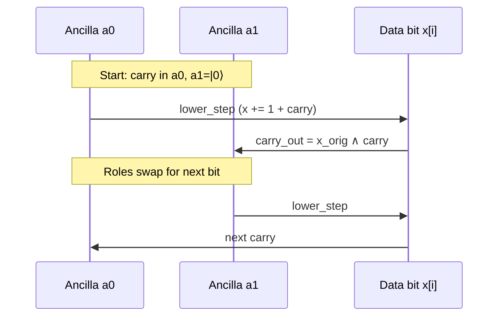

# Goldilocks Field Reduction: Controlled Add Constant

OpenQASM 3.0 implementation of the controlled addition of the constant `(2^{32} - 1)` for Goldilocks field reduction.

## Operation

```
|x⟩ |c⟩ → |x + c ⋅ (2^{32} - 1) mod 2^{64}⟩ |c⟩
```

When `c = 1` (typically from a 2^{64} overflow), this performs the reduction step modulo the Goldilocks prime `p = 2^{64} - 2^{32} + 1`.

## Circuit Flow

```mermaid
flowchart TD
    A[Load ctrl into a0] --> B[Forward Lower 32 bits<br/>Add 1 + carry<br/>a0 ↔ a1]
    B --> C[Forward Upper 32 bits<br/>Add carry only<br/>a0 ↔ a1]
    C --> D[Reverse Upper 32 bits<br/>Uncompute carries]
    D --> E[Reverse Lower 32 bits<br/>Uncompute carries]
    E --> F[Unload ctrl from a0<br/>Ancillae → |0⟩]
    
    style A fill:#1a1a2e,stroke:#9aabba
    style F fill:#1a1a2e,stroke:#9aabba
```

## Ping-Pong Carry (Lower Bits)



## Resources

| Resource | Count |
|----------|-------|
| Qubits (Total) | 67 (64 data + 1 control + 2 ancilla) |
| Toffoli (CCX) | 128 |
| CNOT (CX) | 128 |
| X Gates | 192 (Clifford) |
| Circuit Depth (Toffoli layers) | 128 (sequential ripple-carry) |
| Ancillae | 2 clean qubits (`a0`, `a1`) |

## Design Notes

- Uses a **ping-pong carry** scheme with two ancillae to avoid a full-width carry register.
- Lower 32 bits add the constant `1` (via X) plus carry; upper 32 bits add only the carry.
- Forward pass computes the sum; reverse pass uncomputes the carries so ancillae return to `|0⟩`.
- Compatible with IBM OpenQASM 3.0, Qiskit, and Amazon Braket.
- License: AGPL-3.0

## Verification

1. **Ancilla cleanliness**: `a0` and `a1` return to `|0⟩` (final `ctrl cnot a0` + ping-pong symmetry).
2. **Functionality**: Implements the controlled modular add of `2^{32}-1`.
3. **Goldilocks correctness**: Adding `2^{32}-1` when the high bit overflows implements reduction modulo `p = 2^{64} - 2^{32} + 1`.

### Qiskit Validation

Run the full statevector verification suite:

```bash
pip install qiskit qiskit-aer numpy
python python/qiskit_goldilocks_reduce.py
```

Expected: all 10 test vectors PASS (including wrap-around, MSB carry, field boundary).

### Lean 4 Proof Sketch

See `lean/GoldilocksStep.lean` for classical reversible correctness of `lower_step` / `upper_step` and inverse uncomputation (exhaustive case analysis on basis states).

## Files

- `circuits/goldilocks_controlled_reduce.qasm` — Full explicit unrolled OpenQASM 3.0 circuit.
- `python/qiskit_goldilocks_reduce.py` — Complete Qiskit circuit builder + AerSimulator validation (10 test cases).
- `python/qiskit_validate.py` — Earlier skeleton.
- `lean/GoldilocksStep.lean` — Lean 4 proof sketch of step correctness and ping-pong composition.

## Citation / Provenance

SnapKitty Research Lab — Ahmad Ali Parr.
