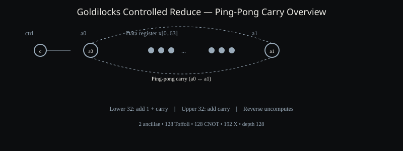
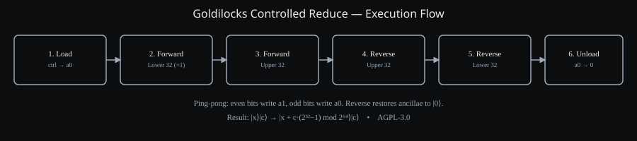

# Goldilocks Field Reduction: Controlled Add Constant



This repository contains an OpenQASM 3.0 implementation of a controlled modular addition circuit specialized for the Goldilocks prime field. The circuit realizes the transformation

\[ |x\rangle |c\rangle \mapsto |x + c \cdot (2^{32}-1) \bmod 2^{64}\rangle |c\rangle \]

using only two clean ancilla qubits. When the control qubit is set (typically as the overflow bit from a preceding 64-bit addition), the operation performs the exact reduction step required by arithmetic modulo the Goldilocks prime \( p = 2^{64} - 2^{32} + 1 \). The design is intentionally resource-efficient: it avoids a full-width carry register by employing a ping-pong carry scheme that reuses two ancillae, trading a modest increase in circuit depth for a large reduction in qubit count.

## What This Repository Is

The Goldilocks field arises in several post-quantum cryptographic constructions and in certain zero-knowledge proof systems because its prime has a particularly convenient form. Arithmetic modulo \( p \) can be performed by ordinary 64-bit arithmetic followed by a cheap correction whenever an overflow occurs. That correction consists of adding the constant \( 2^{32}-1 \). In a quantum setting the same correction must be realized reversibly, and the control bit that indicates overflow must be preserved. The circuit in this repository implements precisely that controlled correction.

The implementation is written in OpenQASM 3.0 so that it can be consumed by IBM Quantum, Qiskit, Amazon Braket, and any other platform that accepts the language. An explicit, fully unrolled form is provided so that every Toffoli, CNOT, and X gate can be inspected and counted. A complete Qiskit Python script reconstructs the same circuit and runs a battery of exact statevector tests that confirm both functional correctness and ancilla cleanliness. A Lean 4 sketch formalizes the classical reversible semantics of the elementary steps and the inverse uncomputation, giving a machine-checked foundation for the ping-pong argument.

## Circuit Architecture

The data register is a 64-qubit array. A single control qubit holds the decision bit. Two ancillae, conventionally named \( a_0 \) and \( a_1 \), serve as the carry register. The algorithm proceeds in six phases:

1. **Load.** The control bit is copied into \( a_0 \) by a CNOT. At this moment \( a_1 \) is still \( |0\rangle \).
2. **Forward lower half.** For each of the least-significant 32 bits the circuit adds the constant 1 together with the incoming carry. The constant is injected by an X gate; the carry is added by a CNOT; the outgoing carry is computed by a Toffoli that uses the original value of the data bit. After each step the roles of the two ancillae are swapped, so the next bit sees the newly computed carry.
3. **Forward upper half.** The most-significant 32 bits receive only the propagating carry (no constant). The same ping-pong pattern continues.
4. **Reverse upper half.** The upper bits are traversed in reverse order with the inverse of the upper step. This restores every intermediate carry to zero while leaving the corrected data bits untouched.
5. **Reverse lower half.** The lower bits are likewise uncomputed. Because the inverse of the lower step also undoes the injected constant, the net effect on the data register is exactly the desired modular addition.
6. **Unload.** A final CNOT between the control and \( a_0 \) returns the ancilla to \( |0\rangle \). Both ancillae are now clean, and the control qubit is restored to its original state.



The ping-pong discipline is the key engineering choice. A conventional ripple-carry adder would require a separate carry qubit for every bit, consuming 64 additional qubits. By alternating the two ancillae the design keeps the ancilla overhead constant while still producing a correct carry chain. The price is a sequential depth of 128 Toffoli layers; for many near-term and early fault-tolerant applications that trade-off is acceptable.

## Resource Counts

| Resource | Count |
|----------|-------|
| Total qubits | 67 (64 data + 1 control + 2 ancilla) |
| Toffoli (CCX) | 128 |
| CNOT | 128 |
| X | 192 |
| Toffoli depth | 128 |
| Ancillae | 2, returned clean |

All counts are exact for the unrolled circuit that appears in `circuits/goldilocks_controlled_reduce.qasm` and are reproduced by the Qiskit builder.

## Verification Strategy

Three complementary methods are supplied.

**Classical reference.** The Qiskit script contains a pure-Python function that computes \( (x + c\cdot(2^{32}-1)) \bmod 2^{64} \). Every quantum execution is compared against this oracle.

**Exact statevector simulation.** Because the circuit is unitary and the test vectors are computational-basis states, the AerSimulator in statevector mode yields a deterministic outcome. Ten carefully chosen vectors exercise the zero case, the pure constant addition, single-bit carries, the MSB, full wrap-around, the exact boundary where the sum equals \( 2^{64} \), and values near the Goldilocks prime itself. In every case the measured data register matches the oracle, the control bit is unchanged, and both ancillae measure zero.

**Formal sketch.** The Lean 4 file `lean/GoldilocksStep.lean` defines the classical action of X, CNOT and Toffoli on a three-bit state and proves, by exhaustive case analysis, that the forward lower step, the forward upper step, and their inverses implement the intended reversible functions. The ping-pong composition is outlined as an inductive argument; the base lemmas are fully formalized.

## Usage

The OpenQASM source can be loaded directly into any compatible compiler or simulator. For local validation:

```bash
pip install qiskit qiskit-aer numpy
python python/qiskit_goldilocks_reduce.py
```

The script prints circuit statistics and a pass/fail report for each test vector. All vectors are expected to pass.

## Design Rationale and Limitations

The circuit is deliberately specialized. It adds only the single constant required by Goldilocks reduction; a general controlled adder would be larger. The sequential ripple structure is simple to verify but is not the asymptotically fastest reversible adder. Parallel prefix or carry-lookahead techniques could reduce depth at the cost of additional ancillae or more complex uncomputation. The present design prioritizes qubit economy and transparency of the carry logic, both of which are valuable when the circuit must later be composed with larger arithmetic pipelines or subjected to formal verification.

The Lean development is a sketch rather than a complete end-to-end proof. Extending it to a full inductive argument over the 64-bit chain, together with a machine-checked correspondence between the OpenQASM text and the Lean model, remains future work. Likewise, the Qiskit validation covers the computational basis; a complete verification would also examine superposition and entanglement, which can be obtained by the same circuit because every gate is unitary and the ancillae are returned to zero.

## Provenance and License

The circuit was developed at SnapKitty Research Lab by Ahmad Ali Parr. It is released under the GNU Affero General Public License version 3. The license text appears in the file `LICENSE`. The choice of AGPL-3.0 ensures that any network service that incorporates a modified version of the circuit must make the corresponding source available to its users.

## Files

- `circuits/goldilocks_controlled_reduce.qasm` — complete, explicitly unrolled OpenQASM 3.0 circuit with helper gates.
- `python/qiskit_goldilocks_reduce.py` — self-contained Qiskit implementation and validation harness.
- `lean/GoldilocksStep.lean` — Lean 4 formalization of the elementary steps and inverses.
- `docs/circuit-overview.svg` — schematic of the data register and ping-pong ancillae.
- `docs/flow.svg` — phase diagram of the six-stage algorithm.
- `LICENSE` — AGPL-3.0.

## Further Reading

The Goldilocks prime and its arithmetic properties are discussed in the literature on efficient finite-field arithmetic for cryptography. Reversible ripple-carry addition, including the use of a constant number of ancillae, has been studied since the early work of Cuccaro et al. and subsequent improvements in the quantum-arithmetic literature. The present construction specializes those techniques to the particular constant and the particular modulus that appear in Goldilocks reduction, and supplies both an executable reference and a formal sketch of correctness.
